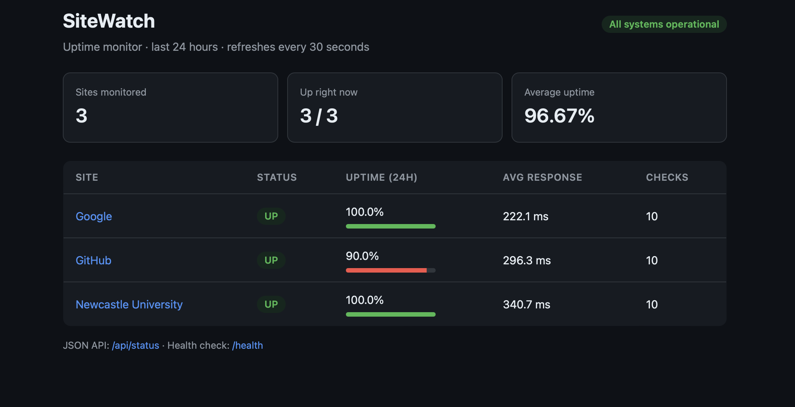

# SiteWatch: Uptime Monitor



A small site reliability tool that checks a list of websites on a schedule, stores every result in SQLite,
alerts when a site goes **down** or **recovers**, and shows uptime and response times on a web dashboard.

## Features
- HTTP health checks with timeouts and expected status codes
- Results stored in SQLite (uptime %, average response time over 24 hours)
- Alerts only on **state changes** (up → down, down → up), so a long outage doesn't flood you with messages
- Telegram and/or email alerts, configured through environment variables
- Flask dashboard (`/`) and JSON API (`/api/status`), plus a `/health` endpoint
- Docker Compose setup, unit tests and GitHub Actions CI

## Run it locally
```bash
python -m venv .venv && source .venv/bin/activate   # Windows: .venv\Scripts\activate
pip install -r requirements-dev.txt
cp .env.example .env                                 # optional: add Telegram/email details
python -m uptime_monitor.monitor --once             # one round of checks
python -m uptime_monitor.monitor                    # keep checking every 60 seconds
python -m uptime_monitor.dashboard                  # open http://localhost:8000
```

Edit `sites.json` to choose which websites to monitor.

## Run with Docker
```bash
cp .env.example .env
docker compose up --build
```

## Tests
```bash
pytest -q
ruff check .
```

## Design decisions
- **Alert on state change only.** Repeated "still down" messages cause alert fatigue, which is a common problem in real on-call teams.
- **The first check alerts only if a site is down**, so starting the monitor doesn't send a burst of "recovered" messages.
- **Network calls are injected** (a `session` parameter), so tests run without the internet.

## Ideas for next steps
- Track latency percentiles (p95) as well as averages
- Add a status history chart to the dashboard
- Retry before alerting to avoid false alarms from one slow request
